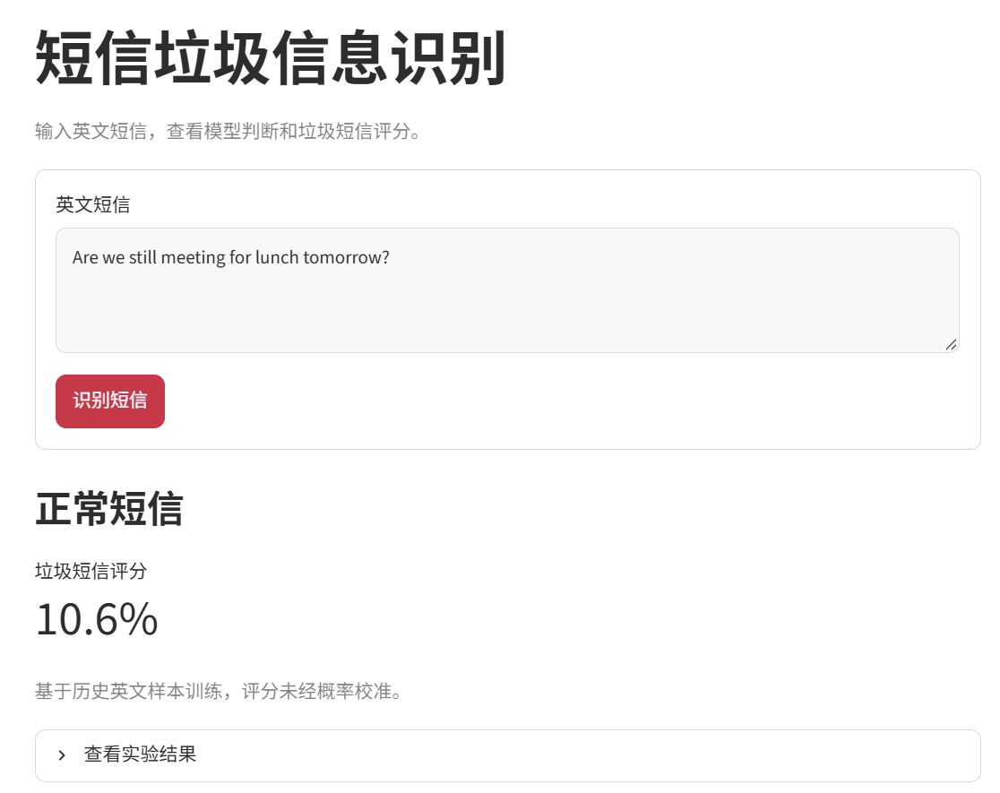
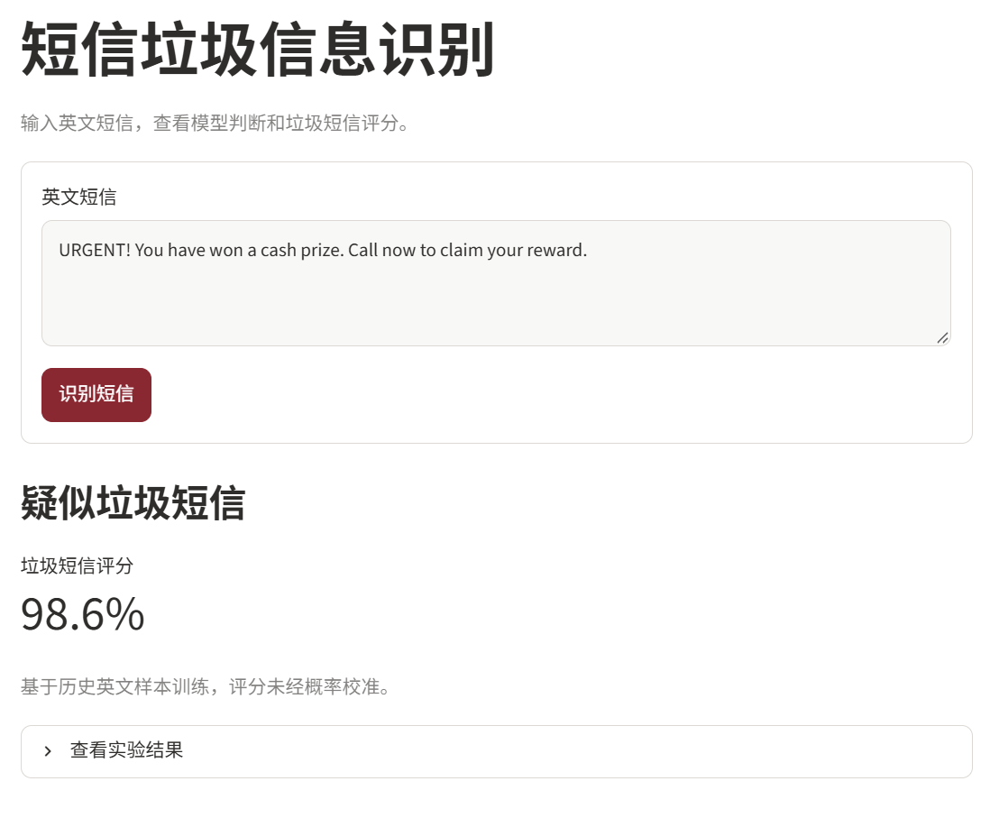

# 英文短信垃圾信息识别

用 UCI 的公开英文短信训练分类器，比较两种模型在同一验证集上的表现，再用独立测试集评估入选模型。整个项目可在 CPU 上运行。

## 运行演示





## 在 Windows 上运行

在项目目录打开 PowerShell，依次执行：

```powershell
python -m venv .venv
.\.venv\Scripts\python.exe -m pip install -r requirements.txt
.\.venv\Scripts\python.exe app.py --train
.\.venv\Scripts\python.exe -m streamlit run app.py --server.address 127.0.0.1
```

第一次训练会下载数据。若自动下载失败，可从 [UCI SMS Spam Collection](https://archive.ics.uci.edu/dataset/228/sms+spam+collection) 下载 ZIP，保存为 `data/sms.zip`，然后重新训练。

## 实验怎么做

1. 读取标签与短信，按小写和折叠空白后的文本去重，剔除标签冲突文本，再按约 60%／20%／20% 分层划分。
2. 用训练集拟合 TF-IDF 与分类器，对比多项式朴素贝叶斯和带类别权重的逻辑回归。前者根据词特征估计类别，后者通过学习词特征的权重划分类别。两种配置同时在分类算法和类别权重上存在差异。
3. 按验证集 Macro-F1 选模型，用训练集和验证集合并后的数据重新训练一次，然后评估测试集。Macro-F1 平等计入两类的 F1，适合补充类别失衡时的准确率。
4. 使用混淆矩阵检查误报与漏报。精确率回答“被拦截的短信里有多少是垃圾短信”，召回率回答“垃圾短信里有多少被拦截”。

训练会生成 `outputs/report.md`（可读实验报告）、`metrics.json`（指标）、`errors.csv`（误报和漏报）、`test_predictions.csv`（测试集预测）、三个划分文件和 `model.joblib`（模型）。结果取决于数据版本和依赖版本，报告记录了实际版本与数据校验值。

演示页面支持输入英文短信，展示模型判断和评分。评分未经概率校准。历史英文数据的指标适用于本次测试划分，模型迁移到其他时间或语言需要重新评估。

## 本地实测结果

原始数据共 5,574 条，去重和清洗后为 5,159 条。验证集上，逻辑回归的 Macro-F1 为 0.9711，垃圾短信召回率为 94.57%。朴素贝叶斯的两项指标分别是 0.9422 和 81.40%，且没有误报正常短信。逻辑回归的正常短信误报率为 0.66%。

入选的逻辑回归在独立测试集的 1,032 条短信上取得 **Macro-F1 0.9604、垃圾短信召回率 94.53%、正常短信误报率 1.22%**。它误报了 11 条正常短信，漏报了 7 条垃圾短信。

- 一条请对方回电话的正常短信得分 62.0%，被误报。其中 `call` 和 `please call` 是贡献最大的两个词特征，分别将逻辑回归的原始分数提高约 1.65 和 0.86。
- 一条写得像日常回电的垃圾短信得分 29.2%，被漏报。虽然它也包含 `call`，但其他词项与模型的截距共同作用后，分数仍低于默认阈值。在这两个例子中，仅看 `call` 无法区分短信的意图。

训练后可运行 `.\.venv\Scripts\python.exe smoke_check.py`，检查正常短信和垃圾短信样例能否通过已保存的模型及 Streamlit 界面得到预期结果。

数据来源与引用见 [UCI SMS Spam Collection](https://archive.ics.uci.edu/dataset/228/sms+spam+collection)。
